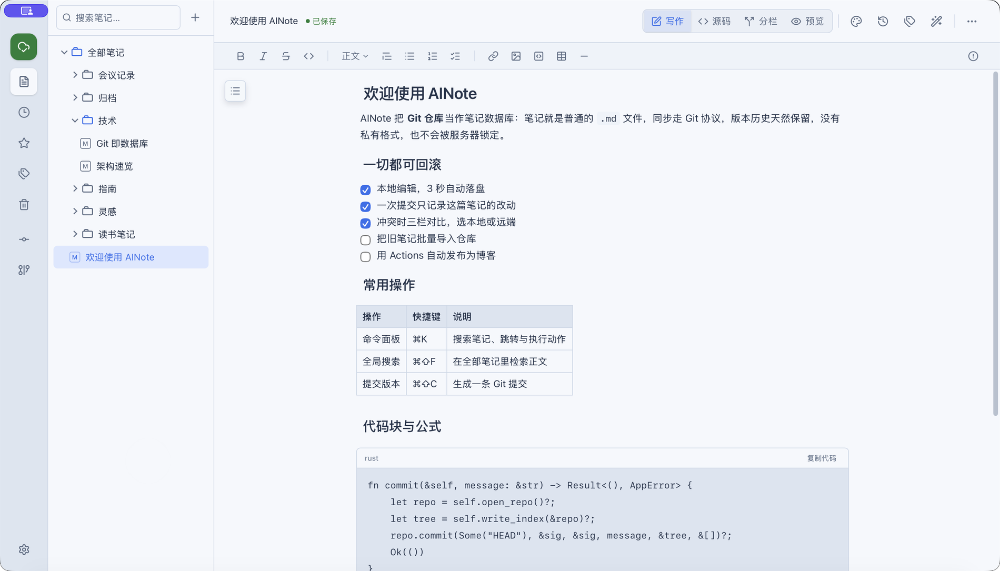
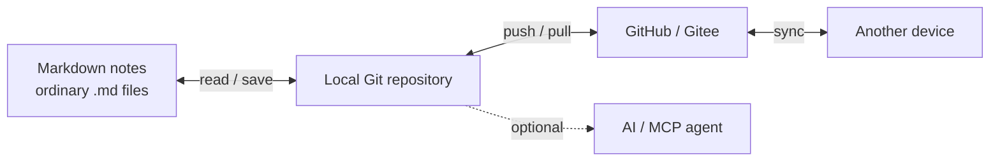
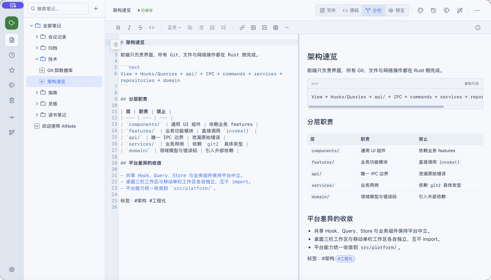
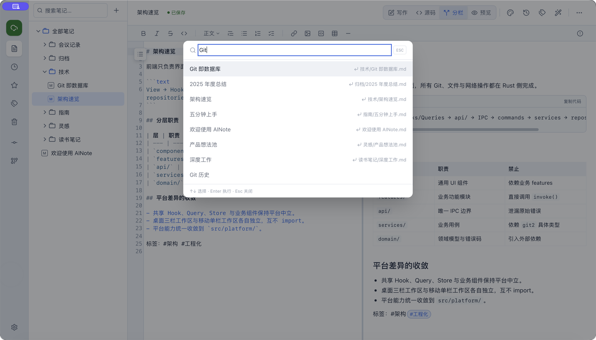
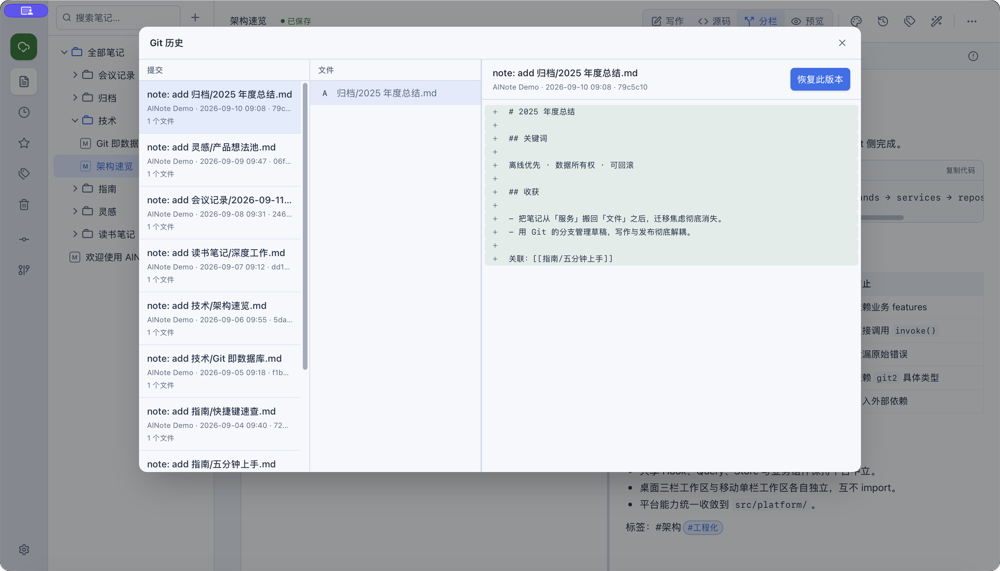
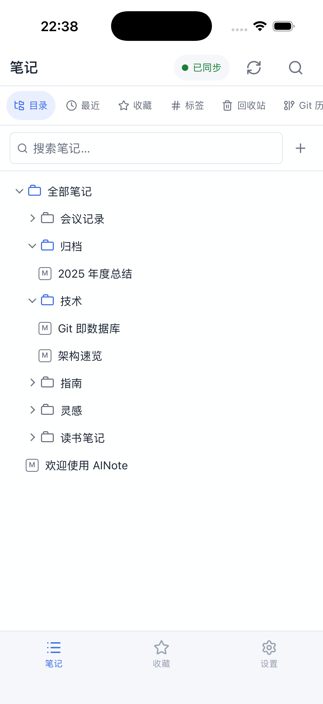
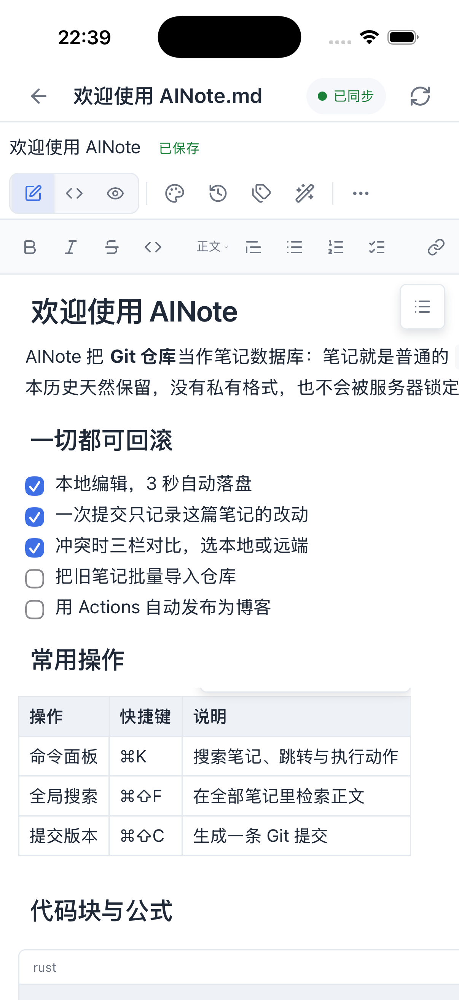
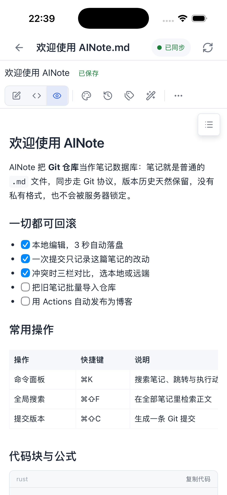

<p align="center">
  
</p>

<h1 align="center">AINote</h1>

<p align="center">
  <strong>Write Markdown. Store Git. Own your notes.</strong><br />
  A cross-platform notes app that treats a Git repository as its database.
</p>

<p align="center">
  <a href="https://github.com/small-dream/AINote/releases/latest"></a>
  <a href="LICENSE"></a>
  <a href="https://github.com/small-dream/AINote/releases/latest"></a>
  <a href="https://v2.tauri.app/"></a>
</p>

<p align="center">
  <a href="#download">Download</a> ·
  <a href="#screenshots">Screenshots</a> ·
  <a href="#features">Features</a> ·
  <a href="#development">Development</a> ·
  <a href="#contributing">Contributing</a>
</p>

<p align="center"><a href="README.md">简体中文</a> · English</p>

> **Your notes should not be trapped in an app's database.**
>
> In AINote, a note is an ordinary `.md` file, a version is a Git commit, and sync is `push` / `pull`. No proprietary format, no cloud black box, and no lock-in that forces you to “export before you leave.”



<p align="center"><sub>CodeMirror soft rendering: write like a document, save clean Markdown underneath.</sub></p>

## Why AINote

- **You actually own the data.** Notes live in your own GitHub or Gitee repository. Switch apps, machines, or hosting providers and take the files with you.
- **History comes standard.** Every commit is a readable, comparable, restorable Git record. Browse history per note or for the whole repository.
- **Offline is first-class.** Browse, search, edit, and commit locally without a network. Push and pull when you reconnect.
- **AI is a tool, not a landlord.** AINote is complete without AI. When configured, it works with OpenAI-compatible APIs or local Ollama, and generated content is written only after you confirm it.
- **Designed for both desktop and mobile.** Desktop emphasizes keyboard flow, split editing, and multiple repositories. Mobile uses single-column navigation, touch targets, and safe areas instead of squeezing the desktop UI down.

## How it works



- **The local repository is the source of truth.** Notes and version history remain complete even when the remote is unavailable.
- **Sync is Git-only.** AINote does not run a notes sync server or require you to upload content to a proprietary note cloud.
- **AI participates only when asked.** Current-note context, library Q&A, and external agent access are explicitly triggered, with confirmation and safety checks before writes.

## Features

### Writing without friction

- **Markdown soft rendering**: headings, task lists, tables, math, Mermaid diagrams, and code blocks are typeset in place while the source remains 100% lossless.
- **Four ways to work**: switch freely between writing, source, split, and preview. Split view is ideal for long-form review and precise Markdown edits.
- **Editable tables and code blocks**: edit table cells in place; code blocks get syntax highlighting, copy, and temporary soft wrapping.
- **Optional rich-text notes**: `.ainote` notes use TipTap with tables, images, task lists, slash commands, and Markdown conversion.
- **Focus tools**: autosave, formatting toolbar, document outline, Markdown diagnostics, and adjustable reading width.

### Find it, then write it

- **Fast retrieval**: ⌘K / Ctrl+K command palette, full-text search, recent notes, favorites, and tag index.
- **Knowledge network**: `[[wiki links]]`, backlink context, `#tags`, and one-click creation of missing linked notes from the backlink panel.
- **Repository organization**: multiple repositories, folder tree, file moves, soft-delete trash, and per-file restoration.
- **Quick capture**: global shortcuts and a tray capture window on desktop; Android can collect text, links, and a single image from the system share sheet.

### Git-native sync

- **Bring your own remote**: bind existing GitHub or Gitee repositories; GitHub repositories can also be created in-app.
- **Clear sync state**: pending, syncing, synced, and conflict states are visible. Offline edits keep waiting for sync when the network returns.
- **One-action Commit / Push / Pull**: review added, modified, and deleted files with an editable commit message; discard local changes when needed.
- **Resolve conflicts without the terminal**: a three-pane merge view lets you choose local or remote content line by line, then finish with an automatic push.
- **Readable, restorable history**: inspect commit history and diffs for a note or the whole repository, then restore any revision.

### AI and MCP

- **Multiple providers and models**: use OpenAI-compatible APIs or local Ollama, with encrypted API key storage.
- **Write and organize**: polish, translate, shorten, expand, continue, summarize, suggest titles and outlines, and ask questions across the library with source locations.
- **Controlled output**: preview AI results before they touch your notes. Core features remain available when AI is not configured.
- **Let agents read and write your notes**: the desktop app includes an MCP server with seven note tools for Cursor, Claude Code, Codex, and other clients. It is off by default, loopback-only (`127.0.0.1`), Bearer-token protected, and wired into the existing draft guard and Git workflow.
- **Simpler client setup**: write local MCP configuration for Claude Code, Codex, Cursor, VS Code, Windsurf, and Cline from Settings; entries update automatically after token rotation or a port change.

### Import, export, and personalization

- **Document import**: desktop supports Markdown, Word (`.docx`), and text-based PDF; mobile supports Markdown. Parsing happens locally.
- **PDF export**: export notes with A4 layout on desktop.
- **Long-form reading**: eight reading themes plus font size, line height, width, and font family controls.
- **Make it yours**: light / dark / system appearance, with Simplified Chinese and English in the app.

## Screenshots

### Desktop

<p align="center">
  
  
  
</p>

<p align="center"><sub>Split editing · ⌘K / Ctrl+K command palette · Git history and version restore</sub></p>

### Mobile

The same notes and the same file format. The mobile shell uses single-column navigation and supports offline editing, search, tags, favorites, trash, attachments, and foreground sync.

<p align="center">
  
  
  
</p>

> The Android build is available now. The iOS build is being prepared for public distribution; the screenshots above are from iOS.

## Download

<p align="center">
  <a href="https://github.com/small-dream/AINote/releases/latest"></a>
</p>

| Platform | Recommended package |
|---|---|
| macOS (Apple Silicon) | `.dmg` |
| Windows | `.msi` or `.exe` |
| Linux | `.AppImage`, `.deb`, or `.rpm` |
| Android | `arm64-v8a` `.apk` |

Desktop packages are not yet Apple-notarized or Windows code-signed, so the first launch may require manual approval. The app includes a signature-checked auto-updater; you can also check manually from **Settings → Software Updates**.

<details>
<summary><strong>Blocked on first launch?</strong></summary>

- **macOS**: if macOS reports that the app is damaged, move `AINote.app` to `/Applications` and run `xattr -cr /Applications/AINote.app`.
- **Windows**: SmartScreen may warn about an unknown publisher. Make sure the installer came from the official project Release page.
- **More help**: see [Installation and troubleshooting](docs/TROUBLESHOOTING.md) for sync failures, expired credentials, low disk space, and package checks.

</details>

> AINote is evolving quickly. Notes are stored in a standard Git repository, but it is still wise to push to your remote or keep a local backup before upgrading.

## Start in three minutes

1. Download and install AINote.
2. Connect GitHub / Gitee and bind an existing repository, or create a new note repository on GitHub.
3. Start writing. Content autosaves into the local Git working tree; commit when you want a version, then sync to the remote in one action.

## Data and privacy

- **No AINote sync server.** Notes sync directly through Git. When you use an online AI provider, the current context is sent only to the provider you choose.
- **Credentials stay out of the frontend.** GitHub tokens and AI API keys use AES-256-GCM encrypted files on desktop and system keychains on mobile; the frontend never receives plaintext.
- **Optional encrypted notes.** The master key lives in process memory by default. On macOS / iOS / Android, device-level quick unlock can be enabled explicitly; key material stays on that device and never enters the repository or Git sync.
- **Safe rendering boundaries.** Markdown is sanitized, and raw HTML is not rendered by default.
- **Diagnostics never contain your notes.** Local logs are redacted before writing and do not include tokens, API keys, note text, or repository paths. There is no remote crash reporting, and diagnostic bundles are created only when you export them.

See [Privacy](docs/PRIVACY.md) for the full collection scope, storage locations, and opt-out controls. Please report vulnerabilities through GitHub [private vulnerability reporting](https://github.com/small-dream/AINote/security/advisories/new), not a public issue.

## Development

<details>
<summary><strong>Prerequisites, run, build, and quality checks</strong></summary>

### Prerequisites

- Node.js 22
- pnpm 10.33.0
- Rust stable
- [Platform dependencies](https://v2.tauri.app/start/prerequisites/) for Tauri 2

### Run and build

```bash
git clone https://github.com/small-dream/AINote.git
cd AINote
pnpm install

# Development: Vite hot reload plus incremental Rust compilation
pnpm desktop:run

# Build a Release executable without producing an installer
pnpm desktop:build

# Produce an installer for the current platform
pnpm desktop:bundle
```

For mobile, use `pnpm android:dev`, `pnpm android:build`, and `pnpm ios:dev`.

### Quality checks

```bash
pnpm build
pnpm test
pnpm lint
cargo test --manifest-path src-tauri/Cargo.toml
```

End-to-end tests are available with `pnpm test:e2e`.

</details>

### Architecture

AINote uses a one-way layered architecture:

```text
View → Hooks/Queries → api/ → IPC → commands → services → repositories → domain
```

- Frontend: React 19, TypeScript strict mode, Vite, Tailwind CSS, TanStack Query, and Zustand.
- Desktop layer: Tauri 2, Rust, `git2`, and AES-GCM encrypted storage.
- Editors: CodeMirror 6 for Markdown and TipTap for rich text.
- Data: the local Git repository is the source of truth; Git, not a private cloud API, is the sync protocol.

For more details, see the [architecture guide](docs/ARCHITECTURE.md), [product requirements](docs/PRD.md), [roadmap](docs/ROADMAP.md), [coding standards](docs/CODING_STANDARDS.md), and [changelog](docs/CHANGELOG.md).

## Contributing

Issues and pull requests are welcome. Please read the related documentation first and preserve the existing architectural boundaries:

1. Fork the repository on GitHub, or create a working branch.
2. Update the relevant living document in `docs/` before changing requirements or architecture.
3. Add tests for core logic alongside your implementation.
4. Ensure all quality checks above pass.
5. Use commit messages in `type(scope): summary` format, such as `feat(note): add tag suggestions`.

If AINote is the kind of notes app you have been looking for, a Star helps others who care about data ownership find it too.

## License

AINote is released under the [MIT License](LICENSE).
