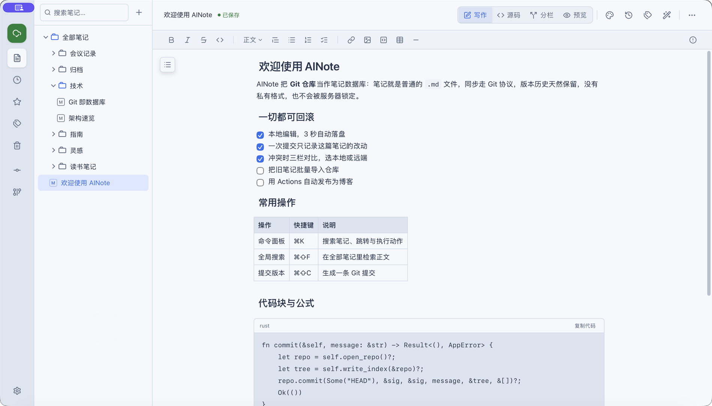
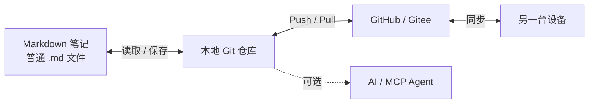
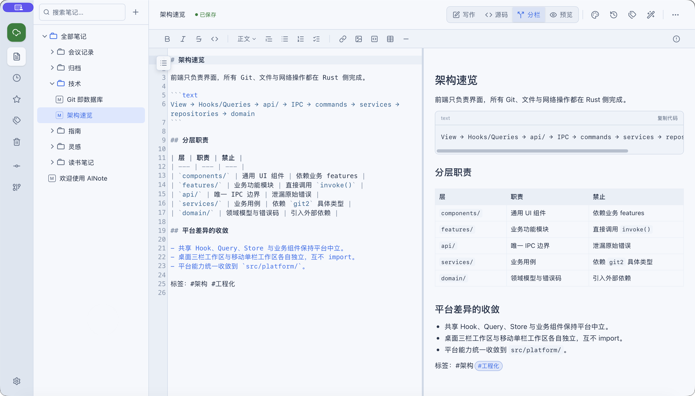
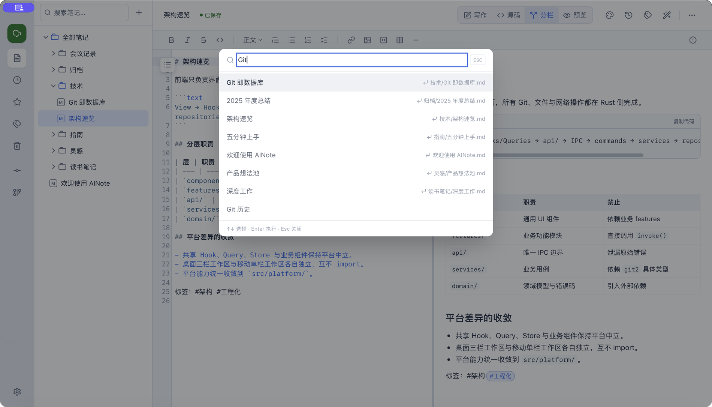
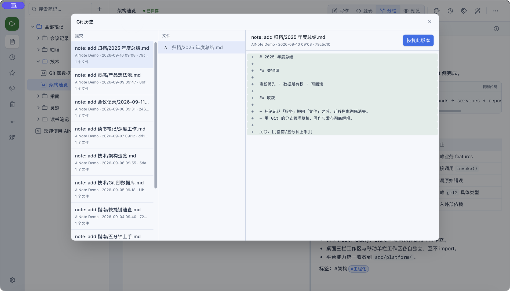
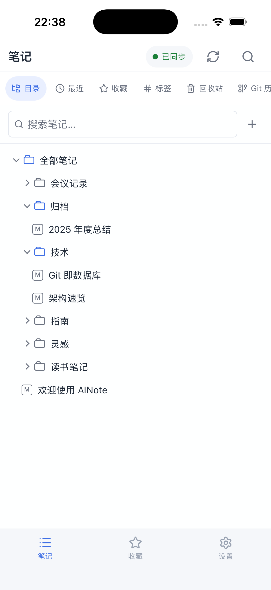
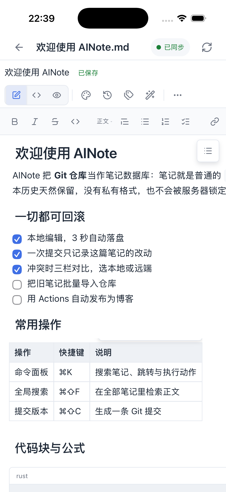
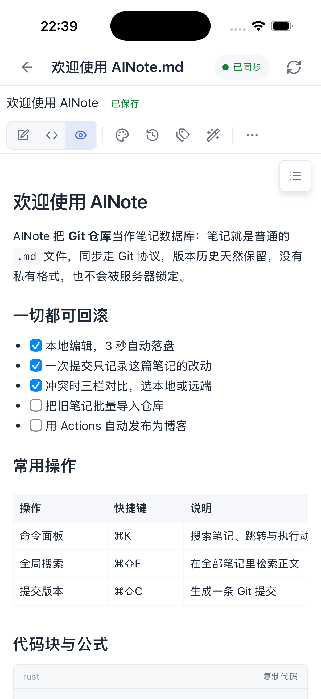

<p align="center">
  
</p>

<h1 align="center">AINote</h1>

<p align="center">
  <strong>写 Markdown，存 Git，永远拥有自己的笔记。</strong><br />
  一款把 Git 仓库当作笔记数据库的跨平台笔记应用。
</p>

<p align="center">
  <a href="https://github.com/small-dream/AINote/releases/latest"></a>
  <a href="LICENSE"></a>
  <a href="https://github.com/small-dream/AINote/releases/latest"></a>
  <a href="https://v2.tauri.app/"></a>
</p>

<p align="center">
  <a href="#下载安装">下载</a> ·
  <a href="#界面预览">界面预览</a> ·
  <a href="#功能一览">功能</a> ·
  <a href="#本地开发">本地开发</a> ·
  <a href="#参与贡献">参与贡献</a>
</p>

<p align="center">简体中文 · <a href="README.en-US.md">English</a></p>

> **你的笔记不该被锁在某个 App 的数据库里。**
>
> 在 AINote 中，笔记就是普通的 `.md` 文件，版本就是 Git 提交，同步就是 `push` / `pull`。没有私有格式，没有云端黑盒，也没有“导出后才能离开”的锁定。



<p align="center"><sub>CodeMirror 软渲染：像在写文档，存下来的仍然是干净的 Markdown。</sub></p>

## 为什么是 AINote

- **数据真正属于你。** 笔记保存在你自己的 GitHub 或 Gitee 仓库里。换应用、换电脑、换托管平台，文件始终可以带走。
- **版本历史不是附加项。** 每次提交都是一条可读、可比较、可恢复的 Git 记录，单篇笔记和整个仓库都能回看。
- **离线不是降级体验。** 浏览、搜索、编辑和本地提交都能在断网时完成，联网后再推送或拉取。
- **AI 是工具，不是房东。** 不配置 AI 也能完整使用；配置后可使用 OpenAI 兼容 API 或本地 Ollama，生成内容确认后才会落笔。
- **为桌面和移动重新设计。** 桌面端强调键盘、分栏与多仓库；移动端使用单栏导航、触控和安全区域，而不是把桌面界面简单缩小。

## 它是怎么工作的



- **本地仓库是权威数据源。** 即使远端不可用，笔记和版本记录仍然完整。
- **同步只走 Git。** AINote 不运营笔记同步服务器，也不要求把内容上传到第三方云笔记平台。
- **AI 只在你需要时介入。** 当前笔记上下文、全库问答和外部 Agent 访问都由用户显式触发，写入前保留确认与安全校验。

## 功能一览

### 写作，不打断思路

- **Markdown 软渲染**：标题、任务列表、表格、公式、Mermaid 图表和代码块就地排版，源码始终 100% 保真。
- **四种工作方式**：写作、源码、分栏和预览自由切换；分栏模式适合长文校对和 Markdown 精细编辑。
- **可编辑表格与代码块**：表格单元格直接编辑，代码块支持语言高亮、复制和临时自动换行。
- **可选富文本笔记**：`.ainote` 使用 TipTap，支持表格、图片、任务列表、斜杠命令，并可转换为 Markdown。
- **专注写作辅助**：自动保存、格式工具栏、文档大纲、Markdown 诊断和可调阅读宽度。

### 找到，再开始写

- **快速检索**：⌘K / Ctrl+K 命令面板、全文搜索、最近笔记、收藏和标签索引。
- **知识网络**：`[[Wiki 双链]]`、反向链接上下文、`#标签`，还能从反链面板一键创建尚未存在的目标笔记。
- **仓库组织**：多仓库切换、目录树、文件移动、软删除回收站与按文件恢复。
- **随手捕捉**：桌面全局快捷键与托盘快速捕捉，Android 可从系统分享面板直接收集文字、链接和单张图片。

### Git 原生同步

- **绑定你自己的远端**：GitHub / Gitee 已有仓库可直接绑定；GitHub 还支持在应用内新建仓库。
- **清晰的同步状态**：待同步、同步中、已同步和冲突状态可见；离线修改会在恢复网络后继续等待同步。
- **一键 Commit / Push / Pull**：提交前展示增、改、删文件与可编辑的提交说明，也可以随时丢弃本地改动。
- **冲突不必碰命令行**：三栏可视化合并，逐行选择本地或远端内容，完成后自动收尾推送。
- **历史可读也可回滚**：查看单篇笔记或整个仓库的提交历史、文件 Diff，并恢复到任意版本。

### AI 与 MCP

- **多 Provider、多模型**：支持 OpenAI 兼容 API 和本地 Ollama，API Key 加密保存。
- **写作与整理**：润色、翻译、缩写、扩写、续写、摘要、标题/大纲建议，以及带来源定位的全库问答。
- **生成可控**：AI 输出先预览，由你确认后才写入笔记；不配置 AI 时核心功能不受影响。
- **让 Agent 读写你的笔记**：桌面端内置 MCP 服务端，Cursor、Claude Code、Codex 等客户端可通过本机端点使用 7 个笔记工具。默认关闭、仅监听 `127.0.0.1`、Bearer Token 保护，写入沿用草稿守卫与 Git 链路。
- **客户端接入更省事**：设置页可一键写入 Claude Code、Codex、Cursor、VS Code、Windsurf 和 Cline 的本机 MCP 配置；轮换 Token 或修改端口后自动更新。

### 导入、导出与个性化

- **文档导入**：桌面端支持 Markdown、Word（`.docx`）和文本型 PDF；移动端支持 Markdown。解析在本地完成。
- **PDF 导出**：桌面端可将笔记按 A4 排版导出为 PDF。
- **长文阅读**：八套阅读主题，以及字号、行高、宽度和字体设置。
- **你的界面**：亮色 / 暗色 / 跟随系统，应用内切换简体中文与 English。

## 界面预览

### 桌面端

<p align="center">
  
  
  
</p>

<p align="center"><sub>分栏写作 · ⌘K / Ctrl+K 命令面板 · Git 历史与版本恢复</sub></p>

### 移动端

同一套笔记、同一套文件格式。移动端采用单栏导航，支持离线编辑、搜索、标签、收藏、回收站、附件和前台恢复同步。

<p align="center">
  
  
  
</p>

> Android 安装包已发布；iOS 版正在准备公开分发，当前截图来自 iOS 构建。

## 下载安装

<p align="center">
  <a href="https://github.com/small-dream/AINote/releases/latest"></a>
</p>

| 平台 | 推荐安装包 |
|---|---|
| macOS（Apple Silicon） | `.dmg` |
| Windows | `.msi` 或 `.exe` |
| Linux | `.AppImage`、`.deb` 或 `.rpm` |
| Android | `arm64-v8a` `.apk` |

桌面安装包目前尚未完成 Apple 公证和 Windows 代码签名，首次打开可能需要手动放行。应用内置签名校验的自动更新器，也可以在 **设置 → 软件更新** 中手动检查。

<details>
<summary><strong>首次打开被系统拦截？</strong></summary>

- **macOS**：若提示“应用已损坏”，把 `AINote.app` 移到 `/Applications` 后执行 `xattr -cr /Applications/AINote.app`。
- **Windows**：SmartScreen 可能提示未知发布者，请确认安装包来自本项目官方 Release 页面。
- **更多问题**：同步失败、凭证失效、磁盘不足和安装包校验见 [安装与故障排查](docs/TROUBLESHOOTING.md)。

</details>

> AINote 仍在快速迭代。虽然笔记保存在标准 Git 仓库中，升级前仍建议推送远端或完成一次本地备份。

## 三分钟开始

1. 下载并安装 AINote。
2. 连接 GitHub / Gitee，绑定一个已有仓库；或在 GitHub 上直接新建笔记仓库。
3. 开始写。内容会自动保存到本地 Git 工作区，需要版本时提交，随后一键同步到远端。

## 数据与隐私

- **没有自建同步服务器。** 笔记同步直接走 Git 远端；使用在线 AI 时，当前上下文只会发送给你选择的 Provider。
- **凭证不暴露。** GitHub Token 与 AI API Key 在桌面端使用 AES-256-GCM 加密文件保存，移动端进入系统钥匙串；前端永远拿不到明文。
- **加密笔记可选。** 主密钥默认只存在进程内存；macOS / iOS / Android 可显式开启设备级快速解锁，密钥材料仅留在本机，不进仓库、不随 Git 同步。
- **渲染有安全边界。** Markdown 渲染经过 sanitize，默认不解析原始 HTML。
- **诊断数据不碰笔记。** 本地日志写入前统一脱敏，不记录 Token、API Key、笔记正文或仓库路径；没有远程崩溃上报，诊断包只在用户主动导出时生成。

完整的采集范围、存储位置与关闭方式见 [隐私说明](docs/PRIVACY.md)。安全漏洞请优先通过 GitHub [私下安全报告](https://github.com/small-dream/AINote/security/advisories/new) 提交。

## 本地开发

<details>
<summary><strong>环境要求、启动、构建与质量检查</strong></summary>

### 准备环境

- Node.js 22
- pnpm 10.33.0
- Rust stable
- Tauri 2 的[平台依赖](https://v2.tauri.app/start/prerequisites/)

### 启动与构建

```bash
git clone https://github.com/small-dream/AINote.git
cd AINote
pnpm install

# 开发模式：Vite 热更新 + Rust 增量编译
pnpm desktop:run

# 构建 Release 可执行文件，不打包安装包
pnpm desktop:build

# 产出当前平台的安装包
pnpm desktop:bundle
```

移动端可分别使用 `pnpm android:dev`、`pnpm android:build` 和 `pnpm ios:dev`。

### 质量检查

```bash
pnpm build
pnpm test
pnpm lint
cargo test --manifest-path src-tauri/Cargo.toml
```

端到端测试使用 `pnpm test:e2e`。

</details>

### 技术架构

AINote 采用单向分层架构：

```text
View → Hooks/Queries → api/ → IPC → commands → services → repositories → domain
```

- 前端：React 19、TypeScript strict、Vite、Tailwind CSS、TanStack Query 和 Zustand。
- 桌面层：Tauri 2、Rust、`git2`、AES-GCM 加密存储。
- 编辑器：CodeMirror 6（Markdown）与 TipTap（富文本）。
- 数据：本地 Git 仓库是唯一权威数据源；同步协议是 Git，而不是私有云接口。

更多细节见 [架构文档](docs/ARCHITECTURE.md)、[产品需求文档](docs/PRD.md)、[产品路线图](docs/ROADMAP.md)、[编码规范](docs/CODING_STANDARDS.md) 和 [更新日志](docs/CHANGELOG.md)。

## 参与贡献

欢迎提交 Issue 与 Pull Request。开始前请阅读对应文档，保持现有架构边界：

1. 在 GitHub 上 Fork 仓库，或创建工作分支。
2. 修改需求或架构前，先更新对应 `docs/` 活文档。
3. 交付代码时同步补充核心逻辑测试。
4. 确保上面的质量检查全部通过。
5. 提交信息使用 `type(scope): summary` 格式，例如 `feat(note): add tag suggestions`。

如果 AINote 的方向正是你想要的，欢迎点一个 Star，或把它分享给同样在意数据所有权的人。

## License

AINote is released under the [MIT License](LICENSE).
